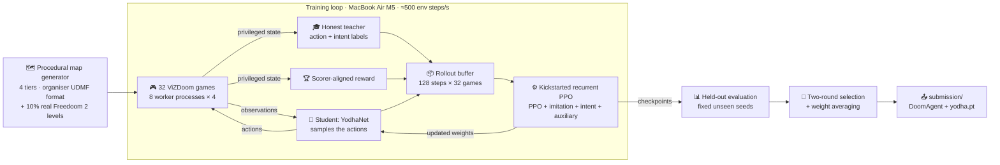
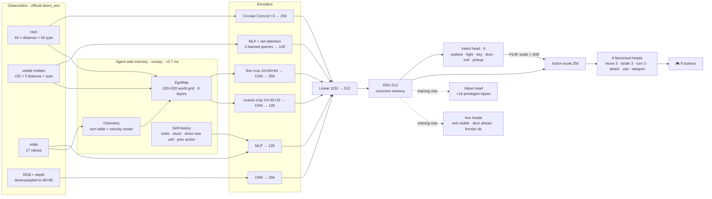
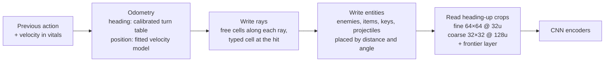
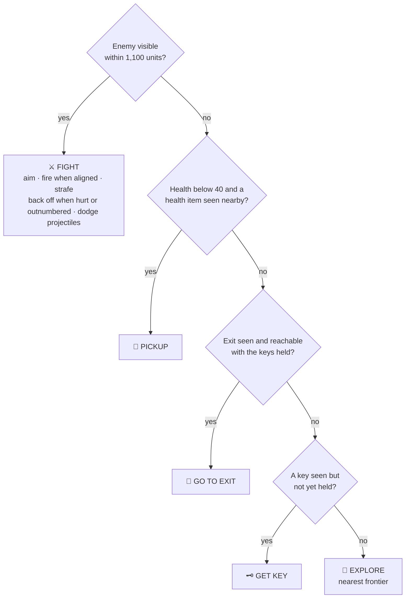
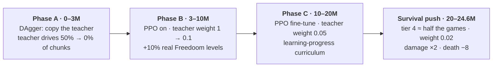
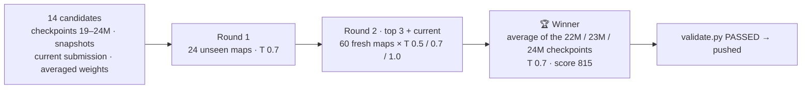

<div align="center">

# YODHA · योद्धा

### A DOOM agent that remembers, explores and finishes levels it has never seen

**Yugaantar 2026 · DevForge · Track 1 "Can It Play DOOM?"**


<sub><b>Glass-box view of the submitted agent on an unseen tier-3 map (2× speed).</b> Left: what the agent sees. Top right: the memory map it builds
itself (fine ±1024 and coarse ±2048 units). Bottom right: what it intends to do and its action probabilities. It explores, picks up the key, goes back
to the locked door and reaches the exit.</sub>

</div>

---

## At a glance

| | |
|---|---|
| 🎯 **Score on 60 unseen maps** | **815**: the privileged teacher that taught it scores 696, random play −38 (tier-weighted proxy of the official categories) |
| 🗝️ **Long-horizon progression** | Tier 3 (key → locked door → exit): **80 %** of levels finished, **100 %** of keys collected |
| 🧠 **Memory** | Builds its own two-scale map of the level from 64 rays and its own odometry, with no coordinates given |
| 🎓 **Training** | Honest privileged teacher → DAgger → kickstarted recurrent PPO, ≈24.6M steps on one MacBook Air |
| ⚡ **Runtime** | 4.42M parameters, ≈3 ms per decision on **one CPU thread** (budget: 40 ms) |
| ✅ **Rules** | Every action comes from trained weights. No rule trees, planners or aimbots in `submission/`, and a test enforces it |

<details>
<summary><b>Contents</b></summary>

1. [The challenge](#the-challenge)
2. [How YODHA works, in one picture](#how-yodha-works-in-one-picture)
3. [What makes it different](#what-makes-it-different)
4. [Architecture](#architecture)
5. [Spatial memory: odometry + EgoMap](#spatial-memory-odometry--egomap)
6. [Training: from an honest teacher to beating it](#training-from-an-honest-teacher-to-beating-it)
7. [Evaluation and model selection](#evaluation-and-model-selection)
8. [Results](#results)
9. [Rules compliance](#rules-compliance)
10. [Repository layout](#repository-layout)
11. [Reproduce](#reproduce)
12. [Limitations and roadmap](#limitations-and-roadmap)
13. [References](#references)

</details>

---

## The challenge

Play **unseen** DOOM levels zero-shot through the official `doom_env` wrapper (ViZDoom 1.3.3, Freedoom 2, skill 3): fight, explore, collect keycards,
open locked doors and reach the exit. The scorer runs hidden maps in four tiers, and harder tiers weigh more.

| Tier | Category | What it tests |
|:---:|---|---|
| 1 | Combat & survival | Aiming, dodging projectiles, managing health and ammo |
| 2 | Multi-room exploration | Partial observability, spatial memory, doors, dead ends |
| 3 | Long-horizon progression | Find a keycard, remember the locked door, backtrack to the exit |
| 4 | Full gauntlet | All of the above with ambushes, scarce resources and multiple locks |

**What the agent gets each step** (ego-centric, partially observable): 64 distance rays over 360° with hit types (wall, door, locked door, enemy, item),
up to 32 visible entities, 17 vitals (health, ammo, key flags, own velocity) and a 120×160 RGB + depth image. **No position, no map.**
**What it returns:** 9 buttons, held for 4 game tics. An episode is 525–1,050 decisions.

**Constraints at evaluation:** 1 CPU thread, 8 GB RAM, 2 GB VRAM, 40 ms of compute per decision, no network. Decisions must come from trained neural
parameters: no `if/else` rule trees, no A*/BFS, no `atan2` aimbots, no off-the-shelf Stable-Baselines3.

---

## How YODHA works, in one picture



At evaluation only the right-hand end ships: `DoomAgent` → odometry + EgoMap → YodhaNet → buttons. The teacher, the reward and all privileged
information exist only in `training/`.

---

## What makes it different

| Idea | What it is | Why it matters for the score |
|---|---|---|
| **EgoMap spatial memory** | A two-scale ego-centric semantic map built from the 64 rays and the agent's own calibrated odometry: walls, doors, locked doors, keys, items, enemies, visited cells, frontier | Remembers *where the locked door was*, so it comes back with the key instead of looping |
| **Honest privileged teacher** | A training-only expert that sees the true map but only *knows* what the student has already observed | Every teacher decision is learnable from the student's own inputs, which closes the imitation gap |
| **DAgger → kickstarted PPO** | The student drives and the teacher labels every visited state; PPO then optimises reward while the teacher's weight fades | Gets key → lock → exit behaviour in millions of steps, not billions, then surpasses the teacher (815 vs 696) |
| **Maps in the organisers' own format** | Procedural UDMF grid maps with the template fixtures' exact door, lock and exit specials, plus real Freedoom levels | Unlimited training variety that matches the evaluation format: generalises instead of memorising |
| **Hierarchical intent head** | explore · fight · get key · open door · go to exit · pickup, conditioning the action heads through FiLM | Interpretable decisions you can watch live in the glass-box view |
| **Scorer-aligned reward** | Exit, keys, doors, unlocks, new rooms, kills, damage and death, from privileged state (training only) | Optimises exactly the categories the judges score |

---

## Architecture



| Block | Output | Parameters | Design choice |
|---|---|---:|---|
| Rays: circular Conv1d ×3 | 256 | 0.29M | Rays form a ring, so the padding wraps around |
| Entities: MLP + 4-head attention, 2 learned queries ("threat", "goal") | 128 | 0.02M | Any number of enemies or items, order-invariant |
| Scalars (vitals, previous action, 13 self-history values) | 128 | 0.02M | "Am I stuck / looping / hurt?" cues; the previous action lets it learn USE timing |
| Pixels: CNN 8×8/4 · 4×4/2 · 3×3 | 256 | 0.47M | Sees what rays can't: the exit floor, exit switches, key colours |
| EgoMap fine crop: CNN 5×5/2 · 3×3/2 · 3×3/2 | 256 | 1.11M | Local layout ±1024 units (the ray range) |
| EgoMap coarse crop: same design | 128 | 0.19M | Far memory ±2048 units: keys, locks, unexplored areas |
| Fusion + GRU 512 | 512 | 2.17M | Short-term memory across steps |
| Intent head + FiLM + 6 action heads | 9 buttons | 0.15M | Hierarchy; 216 valid button combinations instead of 512 raw ones |
| **Shipped total** | | **4.42M** | + 0.14M value and aux heads used only in training |

**Choosing an action:** each head is sampled at **temperature 0.7** from a generator re-seeded every map, so replays are reproducible. Sampling beat
greedy decoding by a wide margin early on (249 vs 37 held-out score), because greedy policies get stuck in loops and corners.

---

## Spatial memory: odometry + EgoMap

The wrapper never reveals the agent's position. YODHA reconstructs it, draws its own map, and feeds that map to the network as images.
**No planning or search ever runs on the map.**



| Component | Detail |
|---|---|
| **Heading** | Doom keyboard turning is deterministic (14.0625° per held step, special first steps). A table keyed on the last 3–4 turn presses gives **≈1.0° drift after 500 steps** |
| **Position** | A linear model of the ego-frame velocity, fitted against privileged pose on training maps: **≈7.4 % of path length** drift |
| **World grid** | 320 × 320 cells × 32 map units, centred on the start, `uint8` |
| **Layers** | free · wall · door · locked door · enemy (fades) · item · key · visited · projectile (fades) |
| **Frontier** | Free cells next to unknown ones, computed per cell (a local test, not a search) |
| **Heading-up crops** | Forward is always "up", so "door up-left → turn left" is the same pattern everywhere |
| **Cost** | ≈0.7 ms per step on one thread |

---

## Training: from an honest teacher to beating it

### The honest privileged teacher (training only)

The teacher reads the true map and pose, but only *knows* what the student has already observed: cells swept by its rays, exits and keys that entered the
90° field of view, and enemies in `visible_entities`. It plans with BFS over that knowledge. It never reaches `submission/`.



Doors on the path are opened with a **single USE press, then a wait**, matching Doom's rule that USE fires on the button-down edge and reverses a moving door.

### Kickstarted recurrent PPO (our implementation)



**Loss** = PPO (clipped policy − entropy) + 0.5 · value + *k* · CE(student, teacher) + 0.5 · CE(intent) + 0.2 · auxiliary

- **DAgger**: the student acts and the teacher labels every state the student visits, so it learns to recover from its own mistakes.
- **Asymmetric critic**: the value head also sees 16 privileged features (distance to goal, keys needed, explored fraction, locks left …), which gives cleaner advantages. It is dropped at export.
- **Auxiliary tasks**: predict "exit visible", "door ahead" and the frontier direction (8 bins).
- **Curriculum**: each tier's sampling weight × (1 + 3·s·(1 − s)), where *s* is its recent exit rate. This favours tiers at 20–80 % success.
- **Survival push** (last ≈4.6M steps): tier-4 deaths had plateaued at ≈57 %, because a full health bar cost the same as one kill paid. Damage and death were made more expensive and tier 4 got about half of the games.

### Scorer-aligned reward (privileged state, training only)

| Event | Reward | Judges' category |
|---|---|---|
| Exit reached | +10, + 2 × health/100, + 2 × (1 − time used) | Exit (largest) |
| Key picked up | +3 | Progression |
| Door / locked door opened (first time) | +1 / +4 | Progression |
| New room (sector) / new 128-unit cell | +0.3 / +0.05 | Exploration |
| Kill | +1 | Combat |
| Damage taken | −0.01 per HP (−0.02 in the survival push) | Survival |
| Death | −5 (−8 in the survival push) | Survival |
| Time · stuck > 8 steps · USE with no door ahead | −0.001 · −0.02 · −0.02 | Efficiency, anti-spin, anti-spam |
| Potential shaping toward the teacher's known goal | 0.02 · (γΦ′ − Φ) | Guidance that leaves the optimal policy unchanged |

### Procedural maps in the organisers' format

Grid levels of 64-unit cells written as **UDMF** with the template fixtures' exact specials: `Door_Raise` (12), `Door_LockedRaise` (13) with locks
129 / 130 / 131, and `Exit_Normal` (243) on GATE floors or exit switches. Each map has random textures, light and heights, and is **checked solvable
by BFS over (cell, keys held)**. Doors are never placed next to locks, because a Doom door only opens to its lowest neighbouring ceiling.

| Tier | Grid (cells) | Rooms | Locks | Monsters | Notes |
|:---:|---|---|:---:|---|---|
| 1 | 12–20 | 1–3 | 0 | 3–9 · easy mix | arenas, 2,100 tics |
| 2 | 20–34 | 5–10 | 0 | 2–7 · mid mix | doors on 45 % of doorways |
| 3 | 22–38 | 6–11 | 1–2 | 3–9 · mid mix | keys in side branches, so it must backtrack |
| 4 | 26–44 | 8–14 | 2–3 | 6–14 · hard mix (cacodemons, hell knights) | chained locks, scarce items, 40 % ambush rooms |

<details>
<summary><b>All hyperparameters</b></summary>

| Parameter | Value | Parameter | Value |
|---|---|---|---|
| γ / GAE λ | 0.995 / 0.95 | PPO clip | 0.2 |
| Parallel games | 32 (8 × 4) | Rollout / TBPTT length | 128 / 32 steps |
| Epochs × minibatches | 2 × 4 | Optimiser | Adam, lr 3·10⁻⁴, linear decay (floor 10 %), ε 1·10⁻⁵ |
| Value / entropy coef | 0.5 / 0.01 → 0.003 | Gradient clip | 0.5 |
| Teacher weight | 1 → 0.1 → 0.05 → 0.02 | Intent / aux weight | 0.5 / 0.2 |
| Real-map probability | 0.1 (phases B, C) | Episodes per generated map | 4 |
| Reward normalisation | ÷ running std of returns, clip ±10 | Checkpoint | every ≈32k steps |
| GRU hidden | 512 | Sampling temperature | 0.7 |
| Total training | ≈24.6M steps (≈98M game tics) | Wall-clock | ≈15 h on a MacBook Air M5 |

</details>

---

## Evaluation and model selection

`training/eval/harness.py` is a scorer replica. It plays **held-out maps with fixed seeds never drawn in training** through the real `DoomAgent` class
on one thread, and scores each map on the official categories:

> exit 50 (+ health and time bonus) · keys 10 · doors 3 · locked doors 8 · rooms visited 20 × fraction · kills 2 · −0.02 per HP · −10 for an early death.
> Tier scores are weighted **1 / 2 / 3 / 4**.



**Model soup:** averaging the weights of consecutive checkpoints of one run cancels the noise of individual updates. It beat the best single checkpoint
by 30–40 points in both rounds.

---

## Results

<picture>
  <source media="(prefers-color-scheme: dark)" srcset="docs/media/results_dark.png">
  
</picture>

### Final comparison: the same 60 unseen maps (15 per tier)

| Agent | Weighted | Tier 1 · combat | Tier 2 · exploration | Tier 3 · key → lock → exit | Tier 4 · gauntlet |
|---|---:|---|---|---|---|
| Random actions | −38 | 2 · exit 0 % | −2 · exit 0 % | −5 · exit 0 % | −5 · exit 0 % |
| Privileged teacher (training only) | 696 | 67 · exit 80 % | **87** · exit 87 % | 104 · exit 73 % · keys 100 % | 35 · exit 7 % · keys 37 % |
| **YODHA (submitted)** | **815** | **70** · exit 80 % | 81 · exit 73 % | **112** · exit 80 % · keys 100 % · locks 95 % | **61** · exit 27 % · keys 63 % |

Highlights:
- **Beats its own teacher overall (815 vs 696), and by 74 % on tier 4 (61 vs 35).** The RL phase learned beyond imitation.
- **Tier 3 solved end-to-end:** every key collected, 95 % of locked doors opened, 80 % of levels finished, with no deaths.
- **Steadier than any single checkpoint:** 12 deaths in 60 maps, against 18 for the previous submission (693 on the same maps).

<details>
<summary><b>Training curves and real Freedoom 2 levels</b></summary>

**Exit rate during training** (rolling averages from the training log):

| Steps | Tier 1 | Tier 2 | Tier 3 | Tier 4 |
|---|---:|---:|---:|---:|
| 4–7M | 59 % | 41 % | 23 % | 4 % |
| 10–13.6M | 77 % | 69 % | 58 % | 14 % |
| 16.5–19.7M | 82 % | 75 % | 67 % | 18 % |
| 21.6M+ (survival push) | 84 % | 77 % | 74 % | 22 % |

**Real Freedoom 2 levels** (MAP01–MAP06: hand-made, far larger and irregular than the training grids, 4,200-tic cap): 56 kills, 11 doors opened,
3 deaths in 6 levels, no exits yet. It fights and explores real levels; finishing them is future work.

</details>

**Runtime (validator, final commit):** init 0.7 s · per decision p50 2.2 ms / p99 2.9 ms · exit reached on the test map · **PASSED**.

---

## Rules compliance

| Rule (docs/RULES.md) | How YODHA complies |
|---|---|
| Decisions from trained neural parameters | `submission/yodha/policy.py` samples the six heads of YodhaNet; nothing else chooses actions |
| No rule trees, A*/Dijkstra/BFS or `atan2` aimbots in the agent | [`tests/test_audit.py`](tests/test_audit.py) parses every file in `submission/` and fails on planners, `atan2`/`arctan2`, `heapq`/`deque` search or any import from `training/` |
| No off-the-shelf Stable-Baselines3 | PPO, kickstarting, the recurrent training loop and the network are our own code. CleanRL was read as a reference only |
| Training-time scaffolding is allowed | Teacher (BFS + aiming), privileged reward and critic live only in `training/` |
| Memory and preprocessing are allowed | Odometry and EgoMap only *store* observations for the CNN; no search runs on them |
| Self-contained, robust inference | numpy + torch only, one thread, warm-up in `__init__`, crash guard in `act()`, weights in Git LFS |

---

## Repository layout

```
submission/                     ← what the judges run
├── agent.py                    DoomAgent: __init__ / reset / act
├── yodha/
│   ├── model.py                YodhaNet: encoders → GRU → intent + FiLM → 6 heads
│   ├── features.py             observation → network inputs, self-history
│   ├── egomap.py               two-scale semantic memory map
│   ├── odometry.py             dead reckoning from actions + velocity
│   └── policy.py               stateful wrapper, temperature sampling
└── weights/                    yodha.pt (Git LFS) · config.json · odometry.json

training/                       ← never imported by submission/
├── mapgen/                     procedural tiered maps → UDMF WADs + solvability check
├── teacher/                    honest privileged teacher (BFS + aiming live here only)
├── envs/                       scorer-aligned reward env + shared-memory workers
├── algo/kickstart_ppo.py       DAgger → kickstarted recurrent PPO
├── calib/                      odometry calibration
├── eval/                       harness · autopilot · two-round finalize · promote
├── viz/glassbox.py             glass-box demo videos
└── configs/                    run settings

tests/                          official tests + rules audit, map generator, agent contract
brief/                          the 2-page project brief (brief.pdf)
docs/                           official contract and rules · our plan, measurements, runbook
```

---

## Reproduce

```bash
uv sync --all-groups                      # Python 3.13, vizdoom 1.3.3, torch 2.15 (same as the official image)
uv run python validate.py                 # official checks
uv run pytest -q tests/                   # official + our tests (incl. the rules audit)
```

```bash
PYTHONPATH=. uv run python -m training.calib.odometry_calibrate                         # fit odometry (once)
PYTHONPATH=. uv run python -m training.teacher.run_teacher --maps 10                     # teacher sanity check
PYTHONPATH=. uv run python -m training.algo.kickstart_ppo --config training/configs/mac.yaml
PYTHONPATH=. uv run python -m training.eval.harness --weights runs/mac_main/export --maps 8
PYTHONPATH=. uv run python -m training.viz.glassbox --weights runs/mac_main/export --tier 3 --out runs/videos/t3.mp4
```

---

## Limitations and roadmap

| Today | Next |
|---|---|
| Tier 4: 27 % exits; heavy ambushes still cause deaths, and the teacher itself only exits 7 % there | A better-fighting teacher (tap-fire, cover, retreat for health) and far longer RL |
| Odometry drifts after collisions and knock-back (≈7 % of path) | Scan-matching: align rays to the map to correct drift |
| Training maps are axis-aligned grids; real Freedoom levels aren't finished yet | More real-map training; a curriculum on harder hand-made levels |
| Map writing is hand-designed | A learned, differentiable map-write module |

---

## References

Schulman et al., *Proximal Policy Optimization* (2017) and *GAE* (2016) · Ross et al., *DAgger* (2011) · Chen et al., *Learning by Cheating* (2019) ·
Schmitt et al., *Kickstarting Deep RL* (2018) · Beeching et al., *EgoMap* (2020) and *Deep RL on a Budget* (2019) · Parisotto & Salakhutdinov, *Neural Map* (2017) ·
Lample & Chaplot, *Playing FPS Games with Deep RL* (2017) · Perez et al., *FiLM* (2018) · Wortsman et al., *Model soups* (2022) ·
Huang et al., *CleanRL* (reference only) · Kempka et al., *ViZDoom* (2016) · Freedoom.

<details><summary>Original template instructions</summary>

See [docs/CONTRACT.md](docs/CONTRACT.md), [docs/RULES.md](docs/RULES.md), [docs/SUBMISSION.md](docs/SUBMISSION.md),
[docs/EVALUATION.md](docs/EVALUATION.md). Quickstart: `uv sync && uv run python validate.py`; Docker: `docker build -t devforge-doom .`
then `python validate.py --docker --image devforge-doom`.
</details>
