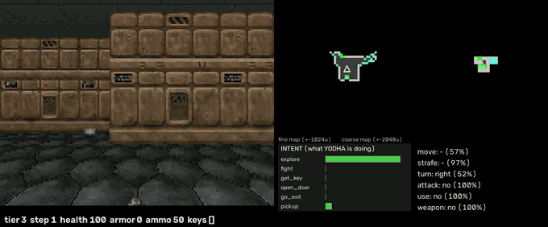
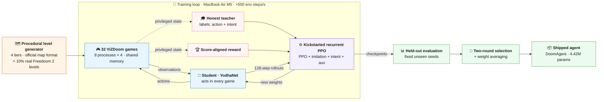
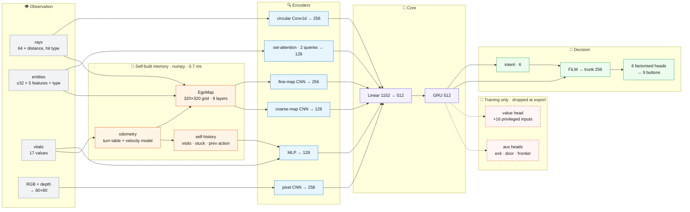
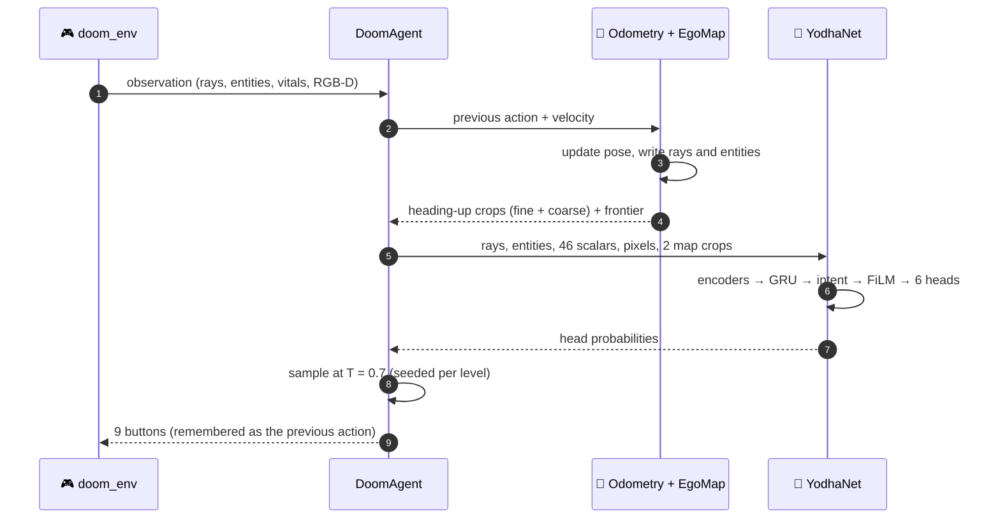
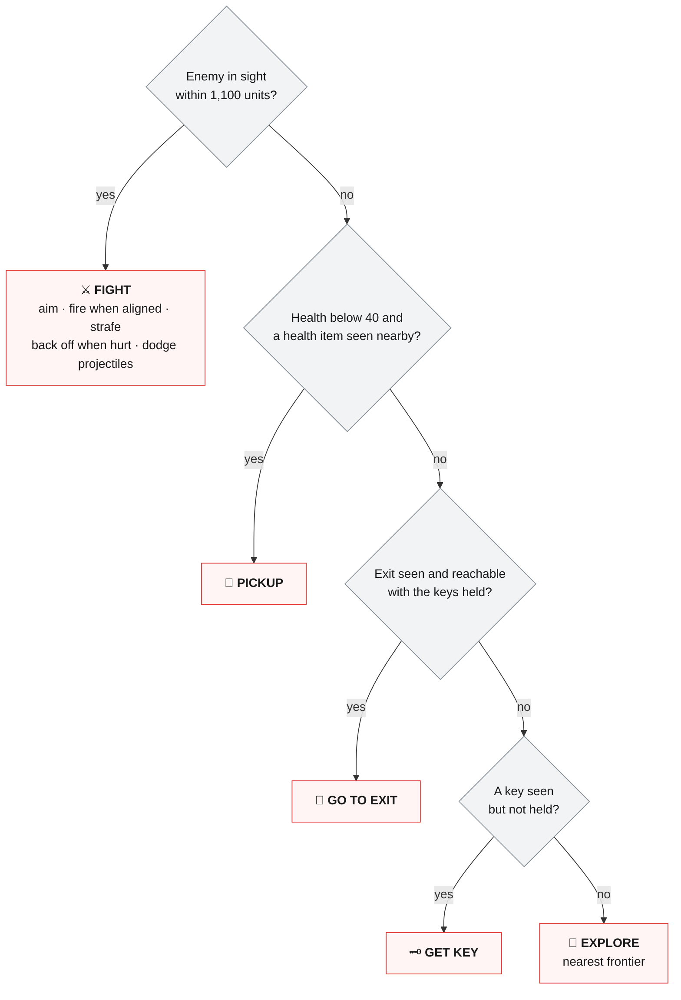
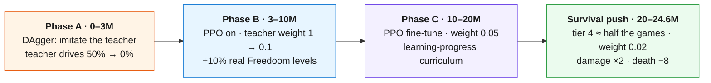
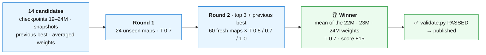
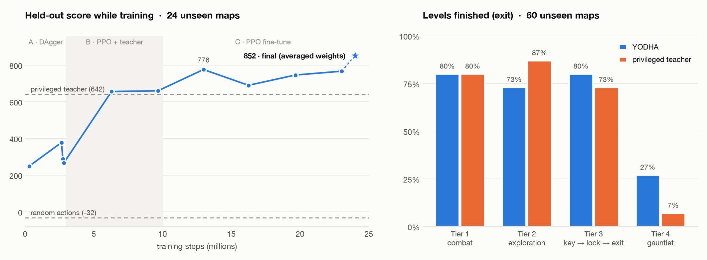

<div align="center">

# YODHA · योद्धा

### A memory-driven reinforcement-learning agent that plays DOOM levels it has never seen

*It builds its own map, learns from an expert that can't cheat, then outgrows it.*




<sub><b>The submitted agent on an unseen tier-3 map (2× speed).</b> Left: what it sees. Top right: the map it draws for itself, fine (±1024 units)
and coarse (±2048). Bottom right: its current intent and action probabilities, live. It explores, picks up the key, returns to the locked door and exits.</sub>

<br>

| **815** | **+17 %** | **100 %** | **4.42M** | **2.2 ms** |
|:---:|:---:|:---:|:---:|:---:|
| score on 60 unseen maps | over the expert that taught it | keys collected on tier 3 | parameters | per decision, 1 CPU thread |

</div>

---

## Contents

[The problem](#the-problem) · [The system](#the-system-in-one-picture) · [Why it works](#why-it-works) · [Engineering decisions](#engineering-decisions-that-moved-the-needle) ·
[Architecture](#architecture) · [Spatial memory](#spatial-memory-odometry--egomap) · [Training](#training-from-an-honest-teacher-to-beating-it) ·
[Selection](#evaluation-and-model-selection) · [Results](#results) · [Guarantees](#guarantees-pure-neural-control) · [Layout](#repository-layout) ·
[Reproduce](#reproduce) · [Roadmap](#limitations-and-roadmap)

---

## The problem

Drop an agent into a DOOM level it has **never seen** and have it finish the level: fight, explore, find keycards, open locked doors, reach the exit.
Levels come in four tiers of difficulty, and harder tiers count more.

| Tier | Category | What it demands |
|:---:|---|---|
| 1 | Combat & survival | Aiming, dodging projectiles, managing health and ammo |
| 2 | Multi-room exploration | Partial observability, spatial memory, doors, dead ends |
| 3 | Long-horizon progression | Find a keycard, remember the locked door, backtrack to the exit |
| 4 | Full gauntlet | All of the above with ambushes, scarce resources and chained locks |

**What makes it hard:**
- 🙈 **No map, no coordinates.** Each step the agent only gets 64 distance rays, up to 32 visible entities, 17 vitals and a 120×160 RGB + depth frame.
- ⏳ **Long horizons.** 525–1,050 decisions per level, and the key you need may sit behind you, three rooms away.
- 🧮 **A tiny budget.** One CPU thread and 40 ms per decision. No network.
- 🚫 **Neural control only.** No hand-written rule trees, no A*/BFS path planning, no `atan2` aimbots, no off-the-shelf RL policies.

---

## The system in one picture



<sub>Dashed red = privileged, training-only components. Only the green end ships: odometry + EgoMap + YodhaNet behind the standard `DoomAgent` interface.</sub>

---

## Why it works

| Idea | What it is | Why it matters |
|---|---|---|
| 🧭 **EgoMap spatial memory** | A two-scale semantic map built from the 64 rays and the agent's own calibrated odometry: walls, doors, locked doors, keys, items, enemies, visited cells, frontier | It remembers *where the locked door was* and comes back with the key instead of looping |
| 🎓 **Honest privileged teacher** | A training-only expert that sees the true map but only *knows* what the student has already observed | Every decision it demonstrates is learnable from the student's own inputs, which closes the imitation gap |
| 🔁 **DAgger → kickstarted PPO** | The student drives and the teacher labels every visited state; PPO then optimises reward while the teacher's pull fades | Key → lock → exit behaviour in millions of steps, not billions, and then the student **beats the teacher** |
| 🗺️ **Unlimited, format-exact levels** | A procedural generator writing UDMF maps with the same door, lock and exit specials as the official test maps, plus real Freedoom levels | Generalisation instead of memorisation |
| 🎯 **Hierarchical intent** | explore · fight · get key · open door · go to exit · pickup, conditioning the action heads through FiLM | Behaviour you can read live (see the GIF) |
| 🏆 **Score-aligned reward** | Exit, keys, doors, unlocks, new rooms, kills, damage and death, computed from privileged state during training | Optimises exactly what is scored |

---

## Engineering decisions that moved the needle

Each of these was a deliberate call, and most are backed by a measurement.

| # | Decision | Why | Measured effect |
|:---:|---|---|---|
| 1 | **Sample actions at temperature 0.7, seeded per level**, instead of greedy argmax | Greedy recurrent policies loop and stick in corners | Held-out score **37 → 249 (6.7×)** at the same checkpoint; still reproducible per map |
| 2 | **Make the teacher "honest"**: it only knows what the student has seen | A god-mode teacher teaches decisions the student can't infer (walking to an unseen key) | ≈**90 % action agreement**, and the student later **beat the teacher (815 vs 696)** |
| 3 | **DAgger with teacher-driven chunks** (teacher drives 50 % → 0 % of 16-step chunks) | Reach deep states (keys, locks) early, then learn recovery from the student's own states | Past the teacher's score on held-out maps by **≈6M steps** |
| 4 | **Generate levels in the official map format** and **verify every one by BFS over (cell, keys held)** | Train on the same "language" as the test maps, with zero unsolvable levels | Caught a silent engine trap: a Doom door next to a locked door **never opens**, so the generator forbids it |
| 5 | **Calibrate odometry from Doom's deterministic turning** | The agent gets no coordinates, but turning is exact (14.0625° per held step) | Heading drift **≈1.0° after 500 steps**; position **≈7.4 %** of path |
| 6 | **Incremental max-pooled coarse map**, vectorised ray writing | Memory must fit a 1-thread, 40 ms budget | Whole EgoMap update **≈0.7 ms per step** |
| 7 | **Shared-memory workers, on-device Gumbel-max sampling** (one GPU sync per step), **encoders run once per training sequence** | A fanless laptop has to train like a small cluster | **≈500 env steps/s, ≈1.7M steps/hour**, **24.6M steps in ≈15 h**, no cloud billing |
| 8 | **Asymmetric critic** (16 privileged features) and **auxiliary tasks** (exit visible, door ahead, frontier direction) | Cleaner advantages and faster feature learning, at zero inference cost | Both are dropped at export: **0.14M training-only parameters** never ship |
| 9 | **Factorised action heads + FiLM intent** | 512 raw button combinations, many contradictory | **216 valid combinations**; intent is visible and interpretable |
| 10 | **Learning-progress curriculum**: tier weight × (1 + 3·s·(1 − s)) | Spend compute where success is 20–80 %, not on solved or hopeless tiers | No hand-tuned schedule; over training, tier-3 exits climbed **23 % → 74 %** |
| 11 | **Data-driven "survival push"** in the final ≈4.6M steps | Logs showed tier-4 deaths flat at ≈57 % for 16M steps; the teacher died on 6/6 tier-4 maps; a full health bar cost the same as one kill | Against the pre-push best on the same 60 maps: deaths **18 → 12**, tier-4 exits **20 % → 27 %** |
| 12 | **Two-round selection on 60 fresh maps + checkpoint weight averaging** | 24-map scores swing ±100 between checkpoints; one lucky map shouldn't pick the model | **+122 points** over the previous best on the same 60 maps (693 → 815); averaging alone **+34 to +43** over the best single checkpoint |
| 13 | **An automated evaluator** testing every new model on fixed unseen seeds every 2 h, promoting only if `validate.py` passes | Never ship an unvalidated model; keep a working agent online at all times | Every published model passed validation; zero broken builds |
| 14 | **CPU-only, 1-thread inference with a warm-up pass** | No CUDA start-up, deterministic, 0 VRAM | **p50 2.2 ms / p99 2.9 ms** against a 40 ms budget (**≈14× headroom**) |
| 15 | **An AST-based rules audit** in the test suite | Neural-only control must be provable, not promised | The build fails if `submission/` ever contains planners, `atan2` or training imports |

---

## Architecture



| Block | Output | Params | Design choice |
|---|---:|---:|---|
| Rays: circular Conv1d ×3 | 256 | 0.29M | The rays form a ring, so the padding wraps around |
| Entities: MLP + 4-head attention, 2 learned queries ("threat", "goal") | 128 | 0.02M | Any number of enemies or items, order-invariant |
| Scalars: vitals, previous action, 13 self-history values | 128 | 0.02M | "Stuck / looping / hurt" cues; the previous action teaches USE timing |
| Pixels: CNN 8×8/4 · 4×4/2 · 3×3 | 256 | 0.47M | Sees what rays can't: exit floors, exit switches, key colours |
| EgoMap fine crop 10×64×64: CNN | 256 | 1.11M | Local layout within ray range (±1024 units) |
| EgoMap coarse crop 10×32×32: CNN | 128 | 0.19M | Far memory (±2048 units): keys, locks, unexplored space |
| Fusion + GRU 512 | 512 | 2.17M | Short-term memory across steps |
| Intent + FiLM + 6 action heads | 9 buttons | 0.15M | Hierarchy; 216 valid button combinations |
| **Shipped total** | | **4.42M** | + 0.14M value and aux heads used only in training |

### One decision step at inference



---

## Spatial memory: odometry + EgoMap

The environment never reveals the agent's position. YODHA reconstructs it, draws its own map and feeds that map to the network as images.
**No planning or search ever runs on the map.** It is memory, not a planner.

| Component | Detail |
|---|---|
| **Heading** | Doom keyboard turning is deterministic (14.0625° per held step, special first steps). A calibrated table keyed on the last 3–4 turn presses → **≈1.0° drift after 500 steps** |
| **Position** | A linear model of the ego-frame velocity in `vitals`, fitted against true pose on training maps only → **≈7.4 %** of path length |
| **World grid** | 320 × 320 cells × 32 map units, centred on the start, `uint8` |
| **Layers** | free · wall · door · locked door · enemy (fades) · item · key · visited · projectile (fades) |
| **Writing** | Free cells along each ray, a typed cell at the hit; entities placed by distance and angle; keys erased when picked up |
| **Reading** | Heading-up crops (forward is always "up"): fine 64×64 @ 32u and coarse 32×32 @ 128u, plus a **frontier** layer (free cells next to unknown) |
| **Cost** | ≈0.7 ms per step on one thread |

---

## Training: from an honest teacher to beating it

### The honest teacher (training only)

It reads the true map and pose, but only *knows* what the student has seen: cells swept by its rays, exits and keys that entered the 90° view, enemies
in sight. It plans with BFS over that knowledge and opens doors with a **single USE press, then waits**, because Doom fires USE on the button-down edge and
reverses a moving door.



### Kickstarted recurrent PPO (implemented from scratch)



**Loss** = PPO (clipped policy − entropy) + 0.5 · value + *k* · CE(student, teacher) + 0.5 · CE(intent) + 0.2 · auxiliary

- **DAgger:** the student acts and the teacher labels the states the student actually reaches, so it learns to recover from its own mistakes.
- **Asymmetric critic:** the value head also sees 16 privileged features (distance to goal, keys needed, explored fraction, locks left …).
- **Curriculum:** each tier's sampling weight × (1 + 3·s·(1 − s)), where *s* is its recent exit rate.

### Score-aligned reward (privileged state, training only)

| Event | Reward | Score category |
|---|---|---|
| Exit reached | +10, + 2 × health/100, + 2 × (1 − time used) | Exit (largest) |
| Key picked up | +3 | Progression |
| Door / locked door opened (first time) | +1 / +4 | Progression |
| New room (sector) / new 128-unit cell | +0.3 / +0.05 | Exploration |
| Kill | +1 | Combat |
| Damage taken | −0.01 per HP (−0.02 in the survival push) | Survival |
| Death | −5 (−8 in the survival push) | Survival |
| Time · stuck > 8 steps · USE with no door ahead | −0.001 · −0.02 · −0.02 | Efficiency, anti-spin, anti-spam |
| Potential shaping toward the teacher's known goal | 0.02 · (γΦ′ − Φ) | Guidance that leaves the optimal policy unchanged |

### Procedural levels

Grid levels of 64-unit cells written as **UDMF** with the official specials: `Door_Raise` (12), `Door_LockedRaise` (13) with locks 129 / 130 / 131,
and `Exit_Normal` (243) on GATE floors or exit switches. Textures, light and heights are randomised, and every level is **verified solvable**.

| Tier | Grid (cells) | Rooms | Locks | Monsters | Notes |
|:---:|---|---|:---:|---|---|
| 1 | 12–20 | 1–3 | 0 | 3–9 · easy mix | arenas, 2,100 tics |
| 2 | 20–34 | 5–10 | 0 | 2–7 · mid mix | doors on 45 % of doorways |
| 3 | 22–38 | 6–11 | 1–2 | 3–9 · mid mix | keys in side branches, so it must backtrack |
| 4 | 26–44 | 8–14 | 2–3 | 6–14 · hard mix (cacodemons, hell knights) | chained locks, scarce items, 40 % ambush rooms |

<details>
<summary><b>All hyperparameters</b></summary>

| Parameter | Value | Parameter | Value |
|---|---|---|---|
| γ / GAE λ | 0.995 / 0.95 | PPO clip | 0.2 |
| Parallel games | 32 (8 × 4) | Rollout / TBPTT length | 128 / 32 steps |
| Epochs × minibatches | 2 × 4 | Optimiser | Adam, lr 3·10⁻⁴, linear decay (floor 10 %), ε 1·10⁻⁵ |
| Value / entropy coef | 0.5 / 0.01 → 0.003 | Gradient clip | 0.5 |
| Teacher weight | 1 → 0.1 → 0.05 → 0.02 | Intent / aux weight | 0.5 / 0.2 |
| Real-map probability | 0.1 (phases B, C) | Episodes per generated map | 4 |
| Reward normalisation | ÷ running std of returns, clip ±10 | Checkpoint | every ≈32k steps |
| GRU hidden | 512 | Sampling temperature | 0.7 |
| Total training | ≈24.6M steps (≈98M game tics) | Wall-clock | ≈15 h on a MacBook Air M5 |

</details>

---

## Evaluation and model selection

`training/eval/harness.py` replicates the scoring. It plays **held-out levels with fixed seeds never drawn in training** through the real `DoomAgent`
class on one thread, and scores each level:

> exit 50 (+ health and time bonus) · keys 10 · doors 3 · locked doors 8 · rooms visited 20 × fraction · kills 2 · −0.02 per HP · −10 for an early death.
> Tier scores are weighted **1 / 2 / 3 / 4**.



**Weight averaging ("model soup")** of consecutive checkpoints cancels the noise of individual updates. It beat the best single checkpoint by 34 points in
round 1 and 43 points in round 2.

---

## Results

<picture>
  <source media="(prefers-color-scheme: dark)" srcset="docs/media/results_dark.png">
  
</picture>

### Head to head on the same 60 unseen maps (15 per tier)

| Agent | Weighted | Tier 1 · combat | Tier 2 · exploration | Tier 3 · key → lock → exit | Tier 4 · gauntlet |
|---|---:|---|---|---|---|
| Random actions | −38 | 2 · exit 0 % | −2 · exit 0 % | −5 · exit 0 % | −5 · exit 0 % |
| Privileged teacher (training only) | 696 | 67 · exit 80 % | **87** · exit 87 % | 104 · exit 73 % · keys 100 % | 35 · exit 7 % · keys 37 % |
| **YODHA** | **815** | **70** · exit 80 % | 81 · exit 73 % | **112** · exit 80 % · keys 100 % · locks 95 % | **61** · exit 27 % · keys 63 % |

- 🥇 **Beats its own teacher overall (815 vs 696), and by 74 % on the hardest tier (61 vs 35).** The RL phase learned beyond imitation.
- 🗝️ **Tier 3 solved end-to-end:** every key collected, 95 % of locked doors opened, 80 % of levels finished, with no deaths.
- 🛡️ **Steady:** 12 deaths in 60 levels, against 18 for the previous best model on the same maps.

<details>
<summary><b>Training curves and real Freedoom 2 levels</b></summary>

**Exit rate during training** (rolling averages from the training log):

| Steps | Tier 1 | Tier 2 | Tier 3 | Tier 4 |
|---|---:|---:|---:|---:|
| 4–7M | 59 % | 41 % | 23 % | 4 % |
| 10–13.6M | 77 % | 69 % | 58 % | 14 % |
| 16.5–19.7M | 82 % | 75 % | 67 % | 18 % |
| 21.6M+ (survival push) | 84 % | 77 % | 74 % | 22 % |

**Real Freedoom 2 levels** (MAP01–MAP06: hand-made, far larger and less regular than the training grids, 4,200-tic cap): 56 kills, 11 doors opened,
3 deaths in 6 levels, no exits yet. It fights and explores real levels; finishing them is on the roadmap.

</details>

**Runtime (validator):** init 0.7 s · per decision p50 2.2 ms / p99 2.9 ms · exit reached on the test map · **PASSED**.

---

## Guarantees: pure neural control

| Requirement | How YODHA meets it |
|---|---|
| Actions come from trained parameters | `submission/yodha/policy.py` samples YodhaNet's six heads; nothing else chooses actions |
| No rule trees, A*/Dijkstra/BFS or `atan2` aimbots at inference | [`tests/test_audit.py`](tests/test_audit.py) parses every file in `submission/` and fails on planners, `atan2`/`arctan2`, `heapq`/`deque` search or any import from `training/` |
| No off-the-shelf RL library policies | PPO, kickstarting, the recurrent training loop and the network are written from scratch (CleanRL read as a reference only) |
| Privileged information only in training | Teacher (BFS + aiming), reward and critic live in `training/`, never imported by `submission/` |
| Memory, not planning | Odometry and EgoMap only *store* observations for the CNN; no search runs on them |
| Robust, self-contained inference | numpy + torch only, one thread, warm-up in `__init__`, crash guard in `act()`, weights in Git LFS |

---

## Repository layout

```
submission/                     ← the shipped agent
├── agent.py                    DoomAgent: __init__ / reset / act
├── yodha/
│   ├── model.py                YodhaNet: encoders → GRU → intent + FiLM → 6 heads
│   ├── features.py             observation → network inputs, self-history
│   ├── egomap.py               two-scale semantic memory map
│   ├── odometry.py             dead reckoning from actions + velocity
│   └── policy.py               stateful wrapper, temperature sampling
└── weights/                    yodha.pt (Git LFS) · config.json · odometry.json

training/                       ← never imported by submission/
├── mapgen/                     procedural tiered levels → UDMF WADs + solvability check
├── teacher/                    honest privileged teacher (BFS + aiming live here only)
├── envs/                       score-aligned reward env + shared-memory workers
├── algo/kickstart_ppo.py       DAgger → kickstarted recurrent PPO
├── calib/                      odometry calibration
├── eval/                       harness · automated evaluator · two-round selection
├── viz/glassbox.py             glass-box videos (the GIF above)
└── configs/                    run settings

tests/                          contract tests + rules audit, map generator, agent interface
brief/                          two-page technical brief (brief.pdf)
docs/                           environment contract and rules · design plan · measurements · runbook
```

---

## Reproduce

```bash
uv sync --all-groups                      # Python 3.13, vizdoom 1.3.3, torch 2.15
uv run python validate.py                 # interface, latency and resource checks
uv run pytest -q tests/                   # all tests, including the rules audit
```

```bash
PYTHONPATH=. uv run python -m training.calib.odometry_calibrate                         # fit odometry (once)
PYTHONPATH=. uv run python -m training.teacher.run_teacher --maps 10                     # teacher sanity check
PYTHONPATH=. uv run python -m training.algo.kickstart_ppo --config training/configs/mac.yaml
PYTHONPATH=. uv run python -m training.eval.harness --weights runs/mac_main/export --maps 8
PYTHONPATH=. uv run python -m training.viz.glassbox --weights runs/mac_main/export --tier 3 --out runs/videos/t3.mp4
```

---

## Limitations and roadmap

| Today | Next |
|---|---|
| Tier 4: 27 % exits; heavy ambushes still cause deaths, and the teacher itself only exits 7 % there | A better-fighting teacher (tap-fire, cover, retreat for health) and far longer RL |
| Odometry drifts after collisions and knock-back (≈7 % of path) | Scan-matching: align rays to the map to correct drift |
| Training levels are axis-aligned grids; real Freedoom levels aren't finished yet | More real-level training; a curriculum on harder hand-made levels |
| Map writing is hand-designed | A learned, differentiable map-write module |

---

## References

Schulman et al., *Proximal Policy Optimization* (2017) and *GAE* (2016) · Ross et al., *DAgger* (2011) · Chen et al., *Learning by Cheating* (2019) ·
Schmitt et al., *Kickstarting Deep RL* (2018) · Beeching et al., *EgoMap* (2020) and *Deep RL on a Budget* (2019) · Parisotto & Salakhutdinov, *Neural Map* (2017) ·
Lample & Chaplot, *Playing FPS Games with Deep RL* (2017) · Perez et al., *FiLM* (2018) · Wortsman et al., *Model soups* (2022) ·
Huang et al., *CleanRL* (reference only) · Kempka et al., *ViZDoom* (2016) · Freedoom.

<div align="center"><sub>Built by <a href="https://github.com/AnshulMohanty">Anshul Mohanty</a></sub></div>
